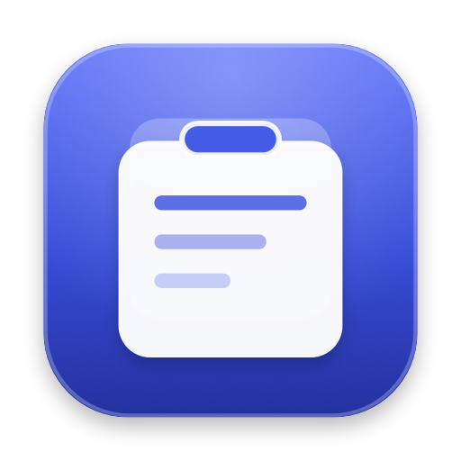
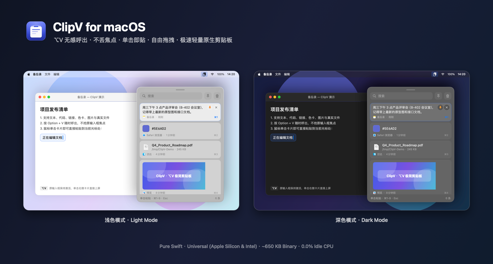
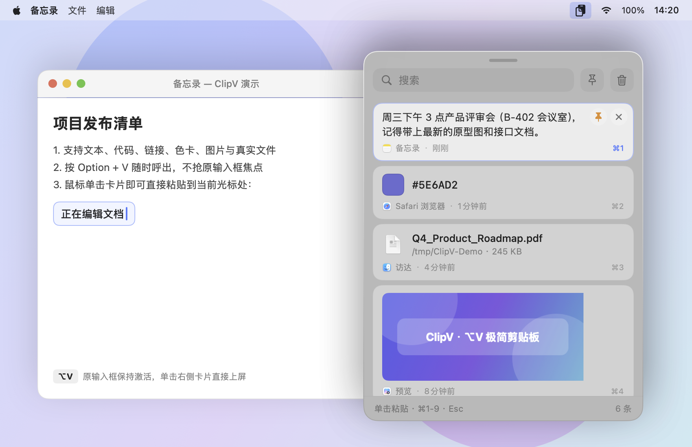
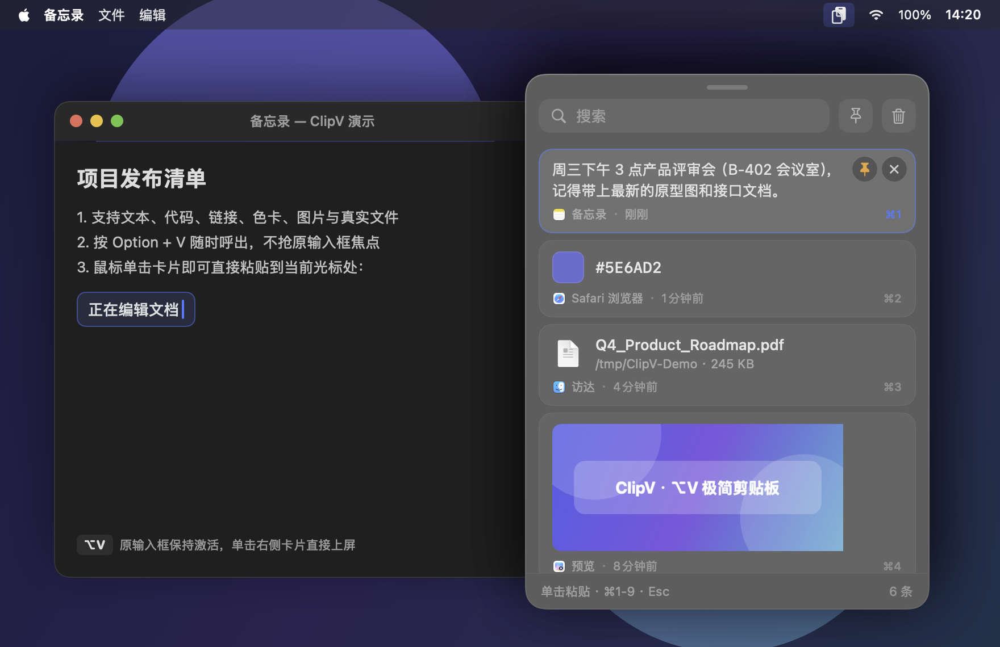

<p align="center">
  
</p>

<h1 align="center">ClipV</h1>

<p align="center">
  <b>极简、轻量、不抢焦点的 macOS 原生剪贴板历史工具</b><br/>
  把 Windows <code>Win + V</code> 般顺手的无感呼出与单击即贴体验带到 macOS
</p>

<p align="center">
  <a href="https://github.com/chen0110-fine/ClipV/releases/latest">
    
  </a>
  
  
  
  <a href="LICENSE">
    
  </a>
</p>

<p align="center">
  
</p>

---


### 对标 Windows 原生剪贴板（`Win + V`）

| 使用体验 | Windows 原生 (`Win + V`) | ClipV for macOS (`⌥V`) |
| :--- | :---: | :---: |
| **快捷键呼出位置** | 随光标 / 窗口附近弹出 | 随鼠标附近弹出，支持**顶部/底栏自由拖动** |
| **不抢输入框焦点** | 原输入框保持聚焦 | **完全不失焦**（`.nonactivatingPanel` + 首击穿透） |
| **点一下直接上屏** | 单击卡片立刻粘贴 | **单击卡片立刻粘贴**（同时支持 `Return` / `⌘1~9`） |
| **置顶 / 单删 / 清空** | 支持 | **全部支持**（悬停轻显图标，零视觉冗余） |
| **文本与图片历史** | 支持文本、截图/图片 | **支持**，并新增 **访达真实文件、代码等宽、HEX 色卡** |
| **历史搜索过滤** | 不支持 | **支持**（点击顶部 `搜索` 即可按内容/文件名/App 筛选） |
| **密码管理器隐私保护** | 不支持 | **支持**（自动过滤 1Password / 钥匙串敏感条目） |
| **开机自启与资源占用** | 系统内置 | **开机自动生效** · 后台待机 `0.0%` CPU · 仅 ~`30~45 MB` 内存 |

---

## 核心特性

* **⌥V 无感呼出，绝不抢走输入框焦点**：采用非激活悬浮面板（`.nonactivatingPanel`）+ 底层 Carbon 全局热键，呼出面板时你原本输入框的光标依然停在原地，**完全不会打断输入**，也不会在输入框里误打出 `√`。
* **单击即贴，像 Windows `Win + V` 一样顺手**：通过首击穿透（First-Mouse）机制，呼出后直接用鼠标**左键点一下**任意卡片即刻粘贴上屏；同样支持全程纯键盘 `↑`/`↓` + `Return` 或 `⌘1~9` 秒贴。
* **自由丝滑拖拽**：按住顶部触控条（或顶栏/底栏任意空白处）即可自由拖动面板位置，拖拽过程同样不会让原输入窗口失焦。
* **全类型智能识别与预览**：
  * **普通文本 / 长文**：卡片内清爽展示多行摘要，附带来源 App 真实图标与相对时间。
  * **代码片段**：自动识别代码特征并使用等宽字体渲染。
  * **链接与 HEX 色值**：自动解析 `#5E6AD2` 等色号并生成可视化色卡块。
  * **图片与截图**：直接记录系统截图与浏览器复制的图片，卡片内嵌圆角缩略图预览。
  * **真实文件（Finder）**：在访达里 `⌘C` 复制文件后，保留真实文件路径与系统文件图标，单击可直接把原文件粘贴到访达、微信或邮件里。
* **隐私保护**：自动忽略 1Password、系统钥匙串、Bitwarden 等密码管理器写入的敏感类型（`ConcealedType` / `TransientType`），不会把密码明文存进历史。
* **极致轻量与开机自启**：零第三方依赖，Universal 双架构可执行文件仅约 **`650 KB`**，后台常驻内存约 **`30~45 MB`**、待机 CPU **`0.0%`**，支持菜单栏一键开启开机自动启动。

---

## 运行示意图

### 浅色模式（Light Mode）
> 呼出 ClipV 时，左侧备忘录输入框仍保持激活与光标聚焦状态，右侧毛玻璃浮窗随鼠标位置弹出，悬停浮现置顶与删除按钮。



### 深色模式（Dark Mode）
> 完美适配 macOS 系统深色外观与 `.hudWindow` 毛玻璃材质，卡片层次清晰克制。



---

## 下载与安装

支持 **macOS 14.0 (Sonoma) 及以上版本**，提供 **Universal 通用包**（同时原生支持 Apple Silicon M1~M4 与 Intel 芯片）。

### 方式一：直接下载 DMG 安装（推荐）

1. 前往 [**Releases 页面**](https://github.com/chen0110-fine/ClipV/releases/latest) 下载 **`ClipV-1.0.0-macOS-Universal.dmg`**（或 `.zip`）。
2. 双击打开 DMG，将 **`ClipV.app`** 拖入 **`Applications`（应用程序）** 文件夹。
3. 由于个人开源项目未购买每年 $99 的 Apple Developer 公证证书，首次打开如提示「无法验证开发者」或「已损坏」，在终端运行一次以下命令清除下载隔离属性即可正常打开：
   ```bash
   xattr -cr /Applications/ClipV.app
   open /Applications/ClipV.app
   ```
4. 点击顶部菜单栏的剪贴板小图标，勾选 **「开机自动启动」**，以后重启电脑即可直接按 `Option + V` 调用。

### 方式二：终端一键安装（自动装好 + 配好开机自启）

打开 macOS「终端」，复制运行这一行命令即可全自动完成下载、安装到 `/Applications`、解除隔离、配置开机自启并立即启动：

```bash
curl -fsSL https://raw.githubusercontent.com/chen0110-fine/ClipV/main/scripts/install.sh | zsh
```

### 方式三：从源码自行编译

本仓库零外部依赖，不需要安装 CocoaPods / Homebrew，只要本机有 Xcode Command Line Tools（自带 `swiftc`）即可 5 秒编译出通用安装包：

```bash
git clone https://github.com/chen0110-fine/ClipV.git
cd ClipV
./scripts/build.sh
```

编译产物会生成在 `build/` 目录下（包含 `ClipV.app`、`.dmg` 和 `.zip`）。

---

## 首次使用：开启「辅助功能」权限

为了实现 **“鼠标点一下 / 按回车直接粘贴到原输入框”**，macOS 安全机制要求授予一次「辅助功能」权限（仅用于发送粘贴按键事件）：

1. 按 **`Option + V`** 呼出 ClipV，点击面板左下角橙色按钮 **「开启辅助功能以自动粘贴 ›」**（或点击顶部菜单栏图标 -> **开启自动粘贴权限...**）。
2. 在弹出的 **系统设置 -> 隐私与安全性 -> 辅助功能** 列表中，打开 **ClipV** 的开关。
3. 授权完成后立刻生效，无需重启；此后重开机权限也会持久保留。

---

## 快捷键一览

| 操作 | 快捷键 / 方式 | 说明 |
| :--- | :--- | :--- |
| **呼出 / 隐藏面板** | `Option + V` (`⌥V`) | 全局生效，不打断原窗口输入状态 |
| **直接粘贴** | 鼠标**单击**卡片 或 `Return` | 关闭面板并将内容直接粘贴至当前光标处 |
| **快速粘贴前 9 条** | `Command + 1` ~ `Command + 9` | 无需动鼠标，秒贴最近 9 条记录 |
| **上下选择** | `↑` / `↓` 方向键 | 切换当前高亮条目 |
| **置顶 / 取消置顶** | `Command + P` 或点卡片右上角图钉 | 置顶条目固定在最上方，清空历史时保留 |
| **删除单条** | `Command + ⌫` 或点卡片右上角 `×` | 删除当前选中记录 |
| **搜索过滤** | 点击顶部 **`搜索`** 框输入关键词 | 支持按内容、文件名、来源 App 名检索（兼容中文输入法） |
| **移动面板** | 拖拽顶部触控条或底部栏 | 任意调整位置，拖动时不丢输入焦点 |
| **关闭面板** | `Esc` / 再按 `⌥V` / 点击面板外区域 | 自动收起浮窗 |

---

## 轻量级数据参考

在 Apple Silicon Mac 上运行实测：

| 指标 | 实测数据 |
| :--- | :--- |
| Universal 双架构二进制大小 | **~652 KB**（单架构约 `300 KB`） |
| 整包体积（含高清 `.icns` 图标） | **1.4 MB**（ZIP 压缩包仅 `989 KB`） |
| 后台常驻内存 | **~30 – 45 MB** |
| 后台待机 CPU | **0.0%**（仅轮询 `NSPasteboard.changeCount` 共享内存计数） |
| 本地存储位置 | `~/Library/Application Support/ClipV/`（最多保留 150 条记录、25 张图片，置顶项不受限） |

---

## 技术实现简述

项目核心逻辑都收敛在单个清晰的 [Sources/ClipV.swift](Sources/ClipV.swift) 中，方便阅读和二次修改：

1. **零焦点丢失架构**：将 `NSPanel` 设为 `[.nonactivatingPanel, .borderless]` 且默认 `canBecomeKey = false`，通过 `orderFrontRegardless()` 浮层呈现；同时对进程内 `NSView.acceptsFirstMouse(for:)` 做了方法交换，确保非 Key 窗口下依然能一击触发点击、悬停和滚轮滚动。
2. **临时接管式键盘导航**：面板展开时通过 Carbon `RegisterEventHotKey` 动态注册 `↑`/`↓`/`Return`/`Esc`/`⌘1~9` 热键，面板隐藏时立即注销，实现“不抢原窗口焦点也能用方向键选词”。
3. **无焦点原生拖拽**：`FocusSafeDragNSView` 基于 `NSApp.nextEvent(matching: [.leftMouseDragged, .leftMouseUp], ...)` 事件跟踪循环实时更新窗口坐标，拖拽顺滑且绝不触发 App 激活。

---

## 卸载方式

如果某天不需要了，运行下面几行命令即可干干净净完全移除（包含自启项、程序本体与本地缓存）：

```bash
launchctl unload ~/Library/LaunchAgents/io.github.chen0110.clipv.plist 2>/dev/null
rm -f ~/Library/LaunchAgents/io.github.chen0110.clipv.plist
rm -rf /Applications/ClipV.app
rm -rf ~/Library/Application\ Support/ClipV
```

---

## 开源协议

本项目基于 [MIT License](LICENSE) 开源，欢迎 Star、提 Issue 或 Fork 改成你喜欢的样子。
